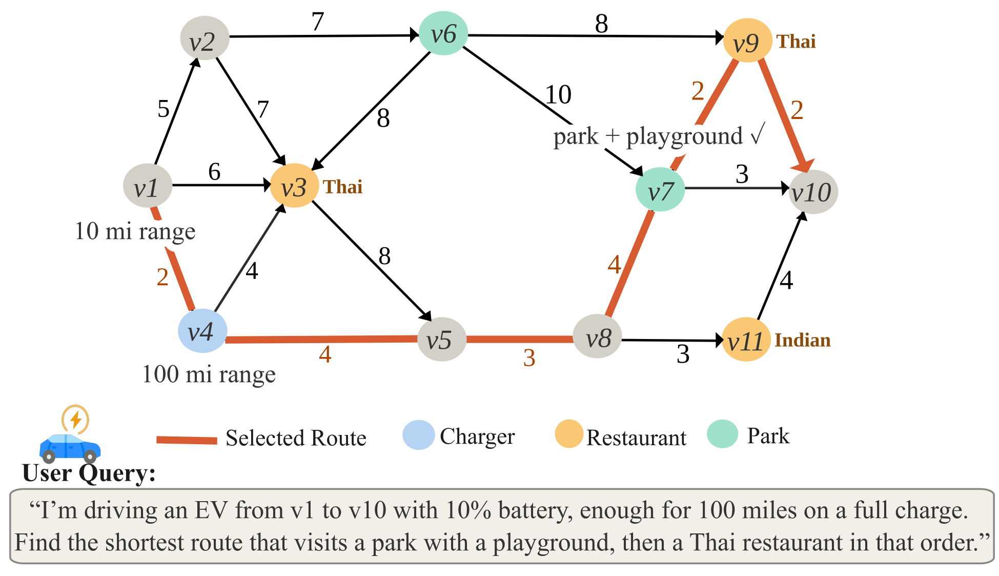
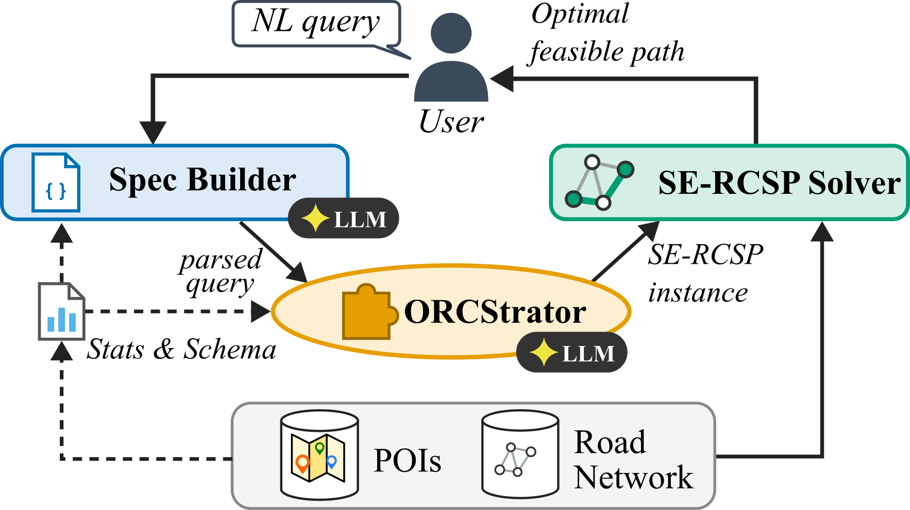

# CRAFT

**Constrained Route planning with Adaptive Framework and Template-based code generation**

Shahd Elmahallawy, Ahmed Eldawy — University of California, Riverside. Under-review [arXiv](https://arxiv.org/pdf/2611.25128)

Everyday routing requests are rarely a point-to-point shortest path. A driver
may need to visit stops, sometimes in a fixed order, under a time budget or
distance limits, and perhaps recharge an EV along the way. Each combination is
a distinct routing problem that classically needs its own algorithm, so no
fixed solver covers the space of queries users actually ask.

CRAFT takes a constrained routing query **as free text** and returns a route
that satisfies it on a real road network. An LLM parses the query and writes
four search functions; one generic graph-search engine executes them.

<p align="center">
  <br>
  <sub><b>Figure 1.</b> A user query and the route that answers it.</sub>
</p>

The query above needs a battery constraint, two stops, and an order, all at
once: the route detours to a charger at *v4*, then takes the park at *v7* and
the restaurant at *v9* in that sequence.

We formalize the underlying problem as **State-Expanded RCSP (SE-RCSP)**, which
extends resource-constrained shortest paths with non-additive state — things
like node-dependent resets (a charger refills the battery) and discrete
progress tracking (how many ordered stops are done). One search engine solves
every instance.

<p align="center">
  <br>
  <sub><b>Figure 2.</b> CRAFT system overview.</sub>
</p>

| Component | Paper | Code | What it does |
|---|---|---|---|
| **Spec Builder** | §5 | `craft/spec_builder/` | Free text → a structured spec: origin, destination, objective, constraints — grounded in the dataset's own categories and units, so the LLM only names things that exist |
| **ORCStrator** | §7 | `craft/orcstrator/` | Spec → an SE-RCSP instance. Assembles the prompt, has the LLM write four function bodies into a fixed template, and matches free-text stop descriptions against POIs |
| **SE-RCSP Solver** | §6 | `craft/se_rcsp_solver/` | Runs the instance on the road network. Query-agnostic — never rewritten per query type |

## Repository guide

```
craft/              the system
craft_hipp/         the same system configured for the LLMAP benchmark
baselines/          the two systems we compare against
benchmark/          query sets, NL templates, ground truth
evaluation/         scoring
scripts/            runners and pipelines
examples/           single-query demo
docs/               figures
data/               datasets (not in git — see Data)
results/            where the exporters write their tables
outputs/            raw per-query JSON from a run
```

### `craft/` — the system

| File | What it is |
|---|---|
| `pipeline.py` | The three stages end to end: parse → generate → execute |
| `build_schema.py` | Builds the POI/road attribute schema for a dataset |
| `spec_builder/prompt.md` | Prompt that turns free text into the structured spec |
| `spec_builder/agent.py` | Runs that prompt, resolves endpoints, normalizes units |
| `orcstrator/prompt.md` | Prompt that writes the four search functions |
| `orcstrator/agent.py` | Runs it, validates the generated bodies, fills the template |
| `orcstrator/tools/filtration.py` | Narrows candidate POIs per stop by category and attributes |
| `orcstrator/tools/poi_embeddings.py` | Matches free-text stop descriptions to POIs |
| `orcstrator/tools/common_handlers.py` | Graph loading, edge weights, node-id handling |
| `se_rcsp_solver/se_rcsp_search.py` | The search engine |
| `se_rcsp_solver/template.py` | The scaffold the generated functions are written into |

### `evaluation/` — scoring

| File | What it is |
|---|---|
| `constraint_checker.py` | The single scorer used for all three systems. Replays a route on the graph and checks every constraint the query stated |
| `metrics.py` | The same checks, run live during a CRAFT run |
| `evaluate_craft.py`, `evaluate_llm.py`, `evaluate_llmap.py` | Export scored results to `results/*.xlsx` |
| `optimal/` | Provably optimal reference solvers, for measuring how far a route is from optimal |

### `benchmark/` — queries and ground truth

| Path | What it is |
|---|---|
| `socal_queries/set1/` | The core query sets |
| `socal_queries/poi_road_pref/` | Highway avoidance |
| `socal_queries/set3_descriptions/` | POI attribute and free-text description filters |
| `socal_queries/llmap_queries/` | The LLMAP benchmark |
| `california_queries/set2/` | Long-distance EV trips on the statewide network |
| `templates/` | The natural-language phrasings each query set is built from |
| `ground_truth/` | Gold answers, written by the generators alongside the queries |

Each query folder holds its queries plus the `generate_*.py` that produced
them. The generators are deterministic and emit their own ground truth; they
refuse to overwrite the published queries unless given `--force`.

### `scripts/` — running things

| File | What it is |
|---|---|
| `run_craft.py`, `run_llm.py`, `run_llmap.py` | Run one system over a query set |
| `run_crafthipp.py` | Same, for the LLMAP benchmark |
| `run_set1.sh`, `run_set2.sh`, `run_set3.sh`, `run_poi_road_pref.sh`, `run_hipp.sh` | Run every system and model over one query set, then score it |
| `run_all.sh` | All of the above except Set 2 |
| `_common.sh` | Models and worker count — edit here to change which LLMs run |

## Setup

1. `pip install -r requirements.txt` (Python 3.12)

2. Point a `.env` at the repo root to an LLM. Fully local, no API key —
   [install Ollama](https://ollama.com), `ollama pull qwen2.5:7b`, then:
   ```
   OPENAI_BASE_URL=http://localhost:11434/v1
   OPENAI_API_KEY=ollama
   ```
   For a cloud model set `GEMINI_API_KEY` / `GEMINI_BASE_URL`, or
   `OPENAI_API_KEY` / `OPENAI_BASE_URL` for a real OpenAI key.

3. Get the data — below.

## Data

`data/` is not in git. Download it and place it at `data/socal/`.
[Download from here.]([https://arxiv.org/pdf/2611.25128](https://drive.google.com/drive/u/0/folders/1EHU_bB0UN9It6M3T0dTQRi080L15cZiE)) 

## Running

One query, end to end — parse, generate, execute — saving everything it
produced, including the generated code:

```bash
python examples/run_example.py
```

Your own query:

```bash
python examples/run_example.py --query "I'm at (33.83, -117.95) and need to get to (33.85, -117.86). Stop at a pharmacy, then a library, in that order."
```

No special syntax — just describe the trip. `benchmark/templates/*.txt` shows
the kinds of constraints that work: EV battery, ordered and unordered stops,
per-leg distance limits, time budgets, highway avoidance, POI attribute and
description filters.

For your own road network, build its schema first, then pass it through:

```bash
python craft/build_schema.py --gpkg <your.gpkg>
python examples/run_example.py --gpkg <your.gpkg>
```

### A whole query set

Each pipeline runs every system and model over one set and scores the result —
raw per-query JSON into `outputs/`, the table into `results/`:

```bash
./scripts/run_set1.sh          # one set
./scripts/run_all.sh           # everything except Set 2
```

Expect hours: each query executes its generated code in its own subprocess,
and every one loads the road graph. While trying things out:

```bash
DRY_RUN=1 ./scripts/run_all.sh     # print the commands, run nothing
./scripts/run_set1.sh --limit 2    # two queries per template
WORKERS=2 ./scripts/run_set1.sh    # fewer parallel workers (each holds a graph)
```

Running one system by hand — the runners share the same flags:

```bash
python scripts/run_craft.py --model gemini-3.1-flash-lite \
    --queries-dir benchmark/socal_queries/set1 --templates ordered_poi --limit 3
```

Which LLMs the pipelines use is set in `scripts/_common.sh`. Note `run_llm.py`
needs `--openai` for a GPT model and `--local` for a locally served one; the
others route by model name.

## Baselines

- `baselines/llm/` — prompts an LLM for a sequence of stops with name, address
  and type, then resolves them against real map data. No search.
- `baselines/LLMAP/` — LLMAP (Yuan et al., EMNLP Findings 2025,
  arXiv:2509.12273), vendored unmodified under its original MIT license. Treat
  as read-only.
